# Sistem Penilaian Isian Singkat Otomatis

Aplikasi untuk mengelola ujian dan menilai jawaban isian singkat dengan bantuan AI.


Repository: [IrvanAfriandi/sistem-penilaian-otomatis-isian](https://github.com/IrvanAfriandi/sistem-penilaian-otomatis-isian)

## Tentang Proyek

Sistem ini membantu pengelolaan kelas, mata pelajaran, siswa, ujian, peserta, dan penilaian jawaban isian singkat. Frontend dibangun dengan React, sedangkan backend menggunakan Flask, MySQL, computer vision, dan NLP untuk mendukung ekstraksi serta penilaian jawaban.

## Fitur Utama

- Dashboard dengan ringkasan statistik aplikasi.
- Pengelolaan kelas, mata pelajaran, dan siswa dengan pencarian.
- Pembuatan ujian, pengelolaan soal dan peserta, serta pemantauan progres.
- Upload jawaban dan ekstraksi teks tulisan tangan dengan model AI.
- Peninjauan jawaban, penilaian otomatis, dan skor per soal.
- Ekspor lembar ujian ke PDF.

## Tampilan Aplikasi

<p align="center">
  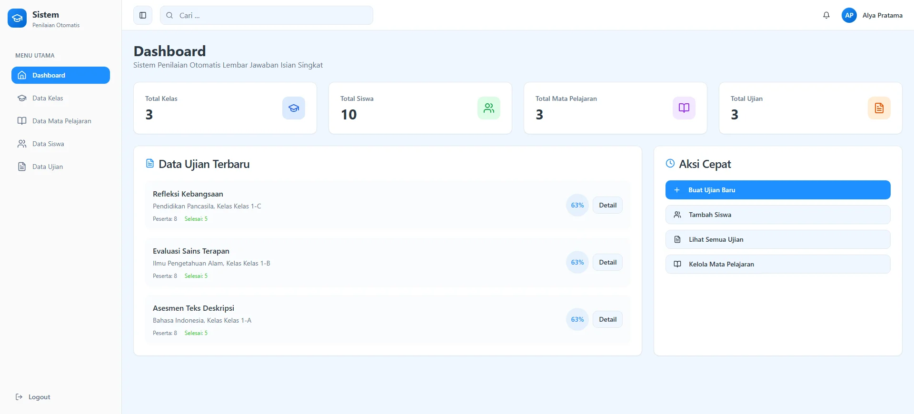
</p>
<p align="center">Dashboard dengan ringkasan statistik ujian dan data aplikasi.</p>

<table>
  <tr>
    <td align="center">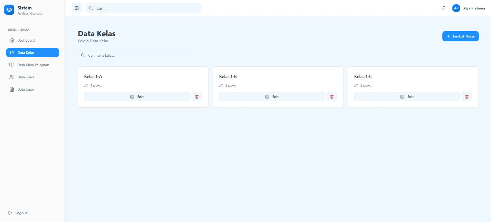<br>Daftar kelas dengan data kelas dan opsi pengelolaan.</td>
    <td align="center">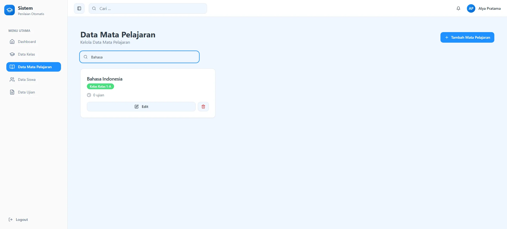<br>Pencarian mata pelajaran dari daftar data.</td>
  </tr>
  <tr>
    <td align="center">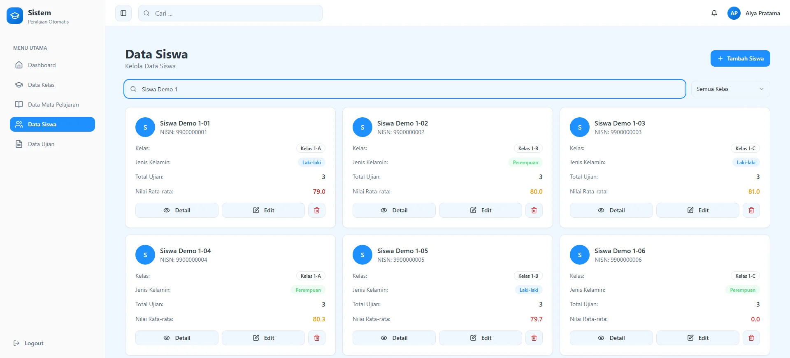<br>Daftar siswa dan informasi kelas.</td>
    <td align="center">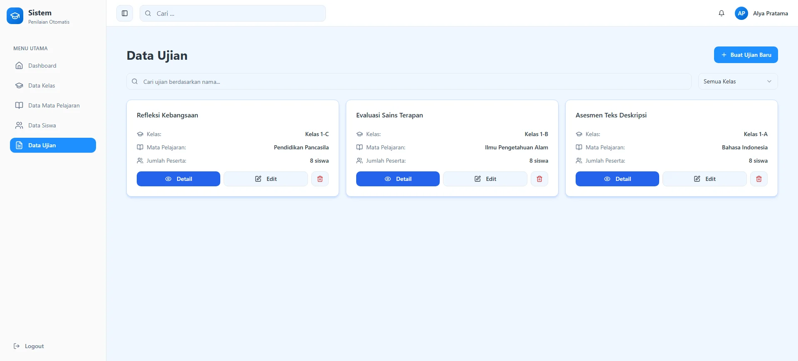<br>Daftar ujian beserta status dan aksi.</td>
  </tr>
  <tr>
    <td align="center">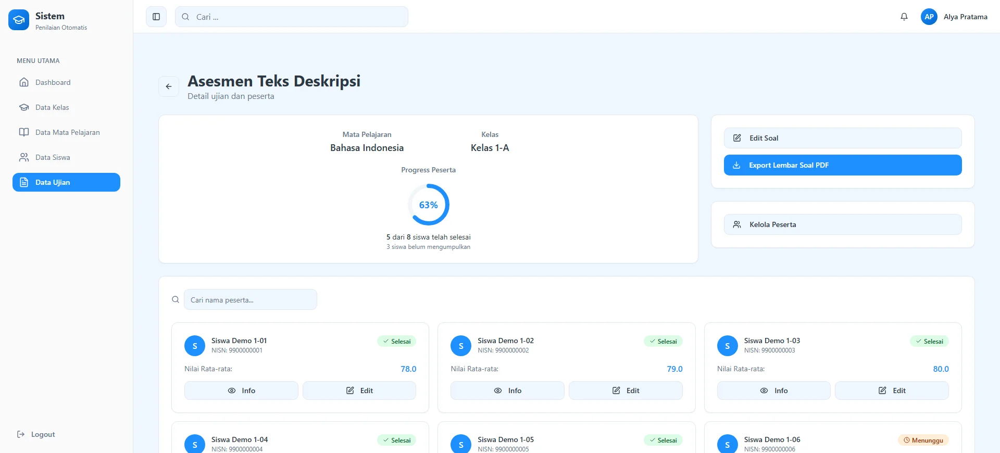<br>Detail ujian, soal, dan peserta.</td>
    <td align="center">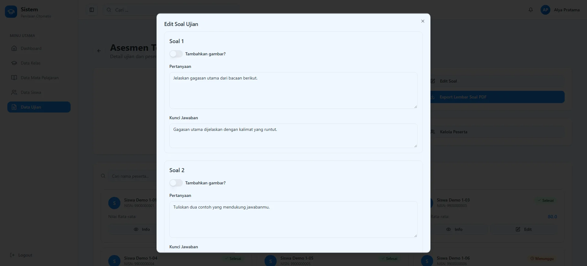<br>Form edit soal ujian.</td>
  </tr>
  <tr>
    <td align="center">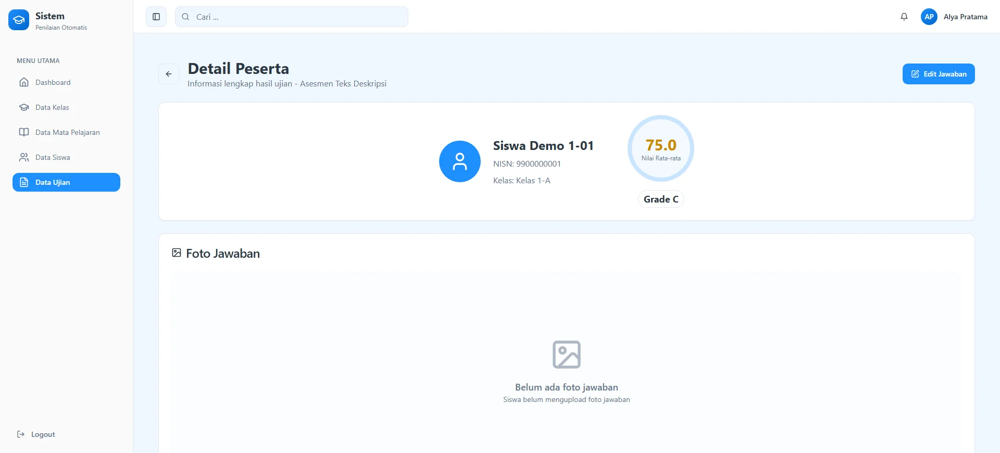<br>Detail jawaban peserta untuk ditinjau.</td>
    <td align="center">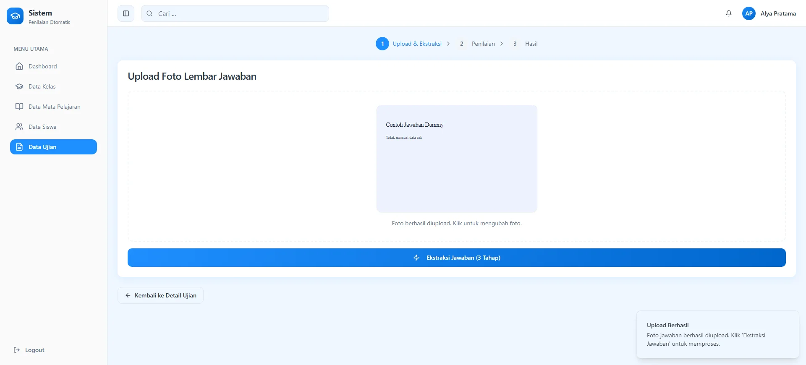<br>Form upload jawaban peserta.</td>
  </tr>
  <tr>
    <td align="center">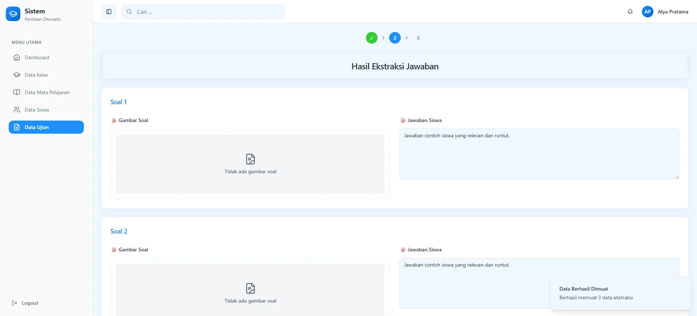<br>Proses penilaian otomatis jawaban.</td>
    <td align="center">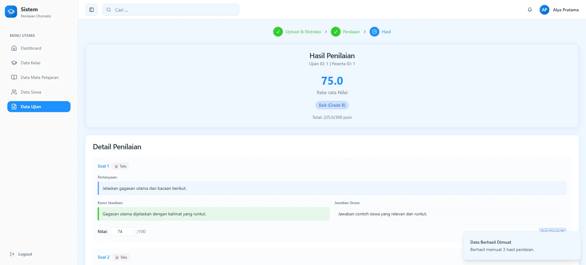<br>Hasil penilaian dan skor peserta.</td>
  </tr>
  <tr>
    <td align="center">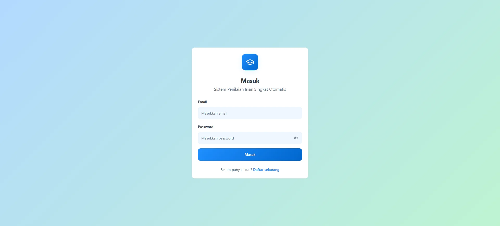<br>Halaman login aplikasi.</td>
    <td></td>
  </tr>
</table>

## Teknologi

| Kategori | Teknologi |
| --- | --- |
| Backend | Python, Flask 3.1, Flask-SQLAlchemy, Flask-JWT-Extended |
| Frontend | React 18, TypeScript, Vite, Tailwind CSS, Radix UI, Recharts |
| Database | MySQL, PyMySQL |
| AI/ML | PyTorch, Ultralytics YOLOv8, CRNN, Transformers, Sentence Transformers |
| Tools | jsPDF, ReportLab |

Aplikasi menggunakan autentikasi JWT. Kode yang tersedia belum menunjukkan pembagian akses berbasis role atau permission; pengguna yang terautentikasi menggunakan alur fitur yang sama.

## Instalasi dan Menjalankan Lokal

### Prasyarat

- Python dengan dependensi yang tercantum di `server/requirements.txt`.
- Node.js dan npm.
- Server MySQL yang dapat diakses secara lokal.
- Tiga model AI yang diperlukan aplikasi.

### Backend

Jalankan perintah berikut dari PowerShell pada Windows:

```powershell
cd server
python -m venv venv
.\venv\Scripts\Activate.ps1
pip install -r requirements.txt
Copy-Item .env.example .env
```

Isi `server/.env` dengan konfigurasi database dan secret lokal. Jalankan backend dengan:

```powershell
python run.py
```

Backend berjalan pada port `5000`. Saat startup, aplikasi membuat tabel yang didefinisikan oleh model SQLAlchemy menggunakan database pada `DATABASE_URL`.

### Model AI

Unduh model berikut dari [folder Google Drive project](https://drive.google.com/drive/folders/1eOK_Vr8I5ygNW2rwBIqrZfVc-n9cmRub?usp=sharing), lalu tempatkan pada `server/app/services/model/`:

- `yolo1.pt`
- `yolo2.pt`
- `crnn.pt`

File model di-ignore oleh Git karena ukurannya besar.

### Frontend

Buka terminal baru dan jalankan:

```powershell
cd client
npm install
npm run dev -- --host 127.0.0.1 --port 8080
```

Frontend tersedia pada `http://localhost:8080`.

## Akun Demo

Project ini tidak menyertakan seeder resmi atau factory untuk membuat akun demo. Akun dummy yang pernah digunakan untuk pengambilan screenshot dibuat oleh helper lokal dan bukan kredensial publik aplikasi.

## Konfigurasi Penting

| Variabel | Fungsi |
| --- | --- |
| `DATABASE_URL` | URI koneksi database MySQL untuk SQLAlchemy. |
| `SECRET_KEY` | Secret aplikasi Flask. |
| `JWT_SECRET_KEY` | Secret untuk menandatangani token JWT. |

Gunakan nilai berbeda dan acak untuk setiap lingkungan. Jangan commit `server/.env`.

## Struktur Folder

```text
.
├── client/
│   └── src/
├── server/
│   └── app/
│       ├── models/
│       ├── routes/
│       └── services/
├── training/
├── screenshots/
├── scripts/
└── server/requirements.txt
```

## Pengujian

Folder test otomatis tidak ditemukan pada project ini. Pemeriksaan frontend yang tersedia dapat dijalankan dengan:

```powershell
cd client
npm run lint
npm run build
```

## Catatan Publikasi

Sebelum membuat repository publik, pastikan file environment, kredensial layanan, dump database, file upload, dataset asli, dan model berukuran besar tidak ikut dipublikasikan. Gunakan `server/.env.example` sebagai template konfigurasi tanpa nilai rahasia.
